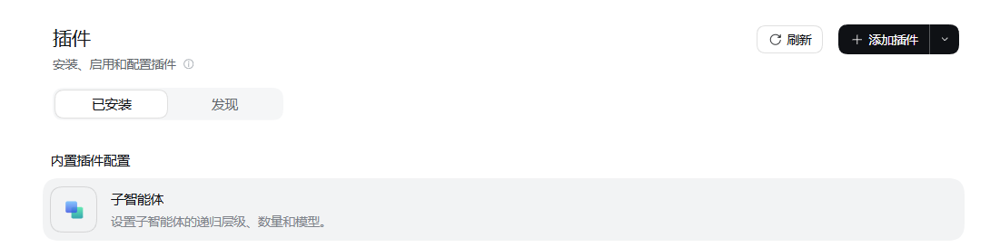
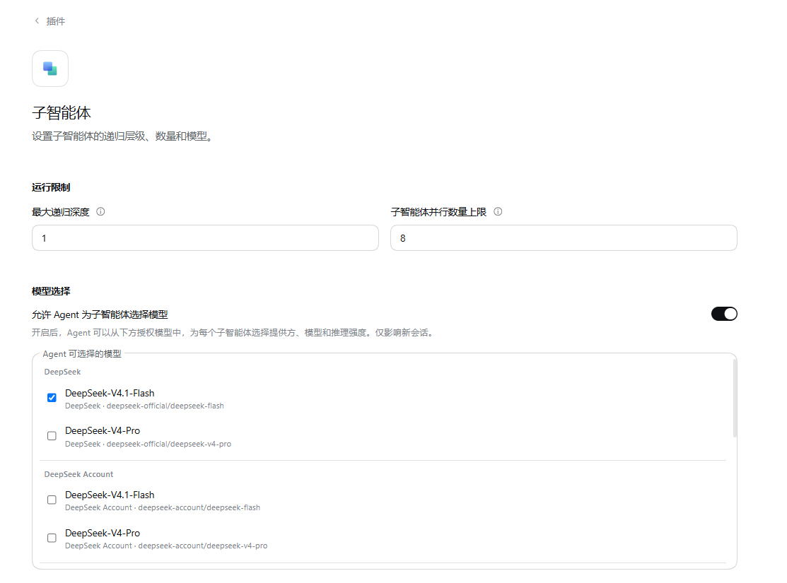
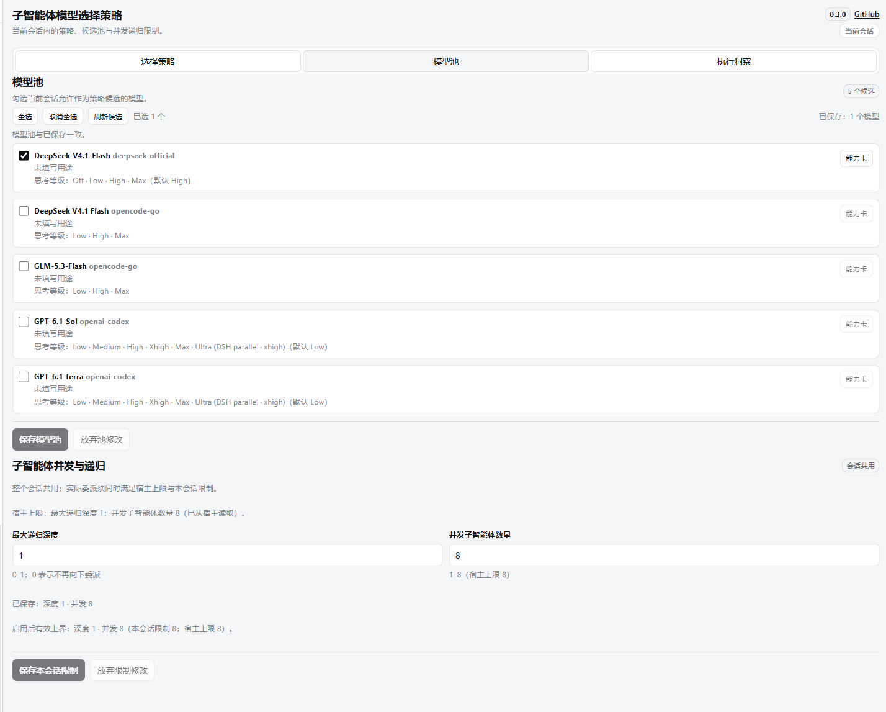

# Subagent Model Policy

[简体中文](https://github.com/ChenMuDX/dsh-subagent-model-policy/blob/main/README.md) · English

[](https://www.npmjs.com/package/@lienze/dsh-subagent-model-policy) [](https://www.npmjs.com/package/@lienze/dsh-subagent-model-policy) [](https://github.com/ChenMuDX/dsh-subagent-model-policy) [](LICENSE) [](https://dsh-plugin.org/plugins/chenmudx/dsh-subagent-model-policy)

Author: lez · Version `0.3.3` · Target host DeepSeek Harness `>=0.2.2-rc.1` (minimum supported) · Node `>=24.12.0`.

> This release uses a numeric version. AC-12 GUI interaction acceptance was confirmed by the user in the real `desktop` app (2026-11-09); the header version badge and GitHub link, and the host-default limit values, were confirmed by the user on the same page (2026-11-10); the 0.3.2 icon and Chinese display name, enabling without saved limits, and filtering imported defaults by host authorization were also confirmed by the user (2026-11-10); 0.3.3 supports both host 0.2.2-rc.1 and 0.2.2-rc.2. Real depth/liveness overflow and similar boundaries remain deferred. Do not describe it as measured for those boundaries.

Manage the model selection policy for subagents in the current session: candidate model pool, session-level concurrency and recursion limits, and the recorded policy and actual response evidence at creation time. Disabled by default; installing it does not change the main model, other sessions' model selection, or host authorization.

## Install

Install from the DeepSeek Harness plugin manager:

```text
@lienze/dsh-subagent-model-policy@0.3.3
```

After installing or updating, reload the plugin and page the way your Harness does; a source change is not a running instance. If your Harness manages profiles through the CLI, add the same package specifier to that profile.

The `@lienze` scope is the publishing account's scope. Internal identifiers keep the historical `lez-` prefix; this does not affect installation, upgrades or stored data.

## First-time use

Follow these steps for a first complete setup; the sections below remain the source of truth for each behavior.

1. **Install and enable the plugin**: finish installing and enabling `@lienze/dsh-subagent-model-policy@0.3.3` in the host's "Plugins" panel, then reload the plugin and page the way your Harness does.



2. **Check the host subagent authorization**: the host's built-in "Subagent" configuration decides the maximum recursion depth, the parallel count ceiling and the models the agent may choose for subagents; this plugin only picks among those host-enabled candidates and never widens host authorization. Confirm both groups of settings on the host side first.



3. **Configure candidates and create a policy**: click the "Subagent Model Policy" button in the session title bar, or the entry with the same name in the right sidebar tabs, to open the three-page panel (the policy switch inside starts off; the main model and host authorization are unaffected by installing). On the "Model pool" page tick the candidates allowed into policies and save — this forms the session pool; then on the "Choose strategy" page create a policy — a fixed model picks one from the session pool, agent choice ticks a subset and adds a selection note — and turn the switch on before saving. Set it as the "New-session default" to let new sessions carry it automatically; an enabled policy takes effect on the next main-agent model call.



4. **Delegate and read evidence**: whether to delegate is still decided by the task. After a delegation, the "Execution insights" page shows the policy captured at creation time and the actual response route; `assistant/message` is the actual-response evidence, `request/header` only the intended request route.

### First-use questions

- **Nothing changed after saving**: saving a still-disabled policy only updates the strategy library; new content of an enabled policy takes effect on the next main-agent model call, and already-created subagents keep their creation-time policy.
- **The expected model is missing**: the pool only shows candidates the host currently allows; enable the model on the host side first — the plugin does not manage API keys or authorization.
- **A "model mismatch" error at delegation**: under a fixed policy a mismatch fails instead of silently switching; if a native entry is refused because it cannot name the target model, use `delegate_with_policy`.
- **Switching or stopping a policy**: turn the switch off — the policy is kept, the main model does not change and already-created subagents are not terminated; the enabled policy and the source of the "New-session default" must be closed or changed before deletion.

## Entry points

The "Subagent Model Policy" button in the session title bar, or the entry with the same name in the right sidebar tabs. The panel has three pages:

- **Choose strategy**: policy switch, new-session default switch, strategy library and in-page editing.
- **Model pool**: candidate selection, refresh candidates, ability cards, session concurrency/recursion limits.
- **Execution insights**: real creations and response evidence recorded by this plugin.

## Policy semantics

- **Fixed model**: delegation only uses the selected model; a mismatch fails instead of silently switching.
- **Agent choice**: the agent picks from the session pool's candidate subset and must supply an exact provider/model when delegating.
- The legacy "follow parent model" policy is kept read-only; saving as fixed or agent choice converts it explicitly.
- After saving an enabled policy, the new content takes effect on the next main-agent model call; saving a disabled policy only updates the strategy library.
- Saving without changes does not create a new revision; the UI does not show internal revision numbers.
- The enabled policy and the source strategy of the new-session default cannot be deleted; close the policy or change/clear the default first.
- Setting a new-session default does not raise a top banner; only the "New-session default" summary updates.
- Closing the policy does not delete it, does not change the main model, and does not terminate subagents already created.

## Model pool and limits

- The model pool only lists candidates the host currently allows; selecting them does not widen host authorization, and the plugin does not manage API keys, connections or official authorization.
- Candidates referenced by the enabled policy are protected; removing them is refused with a prompt to adjust or close the policy first.
- "Refresh candidates" drops candidates that became invalid at the moment of the request and cleans their stale references in policies; the currently enabled content stays protected.
- Model rows show the thinking levels and ability cards provided by the host; when the host provides none, no level names are guessed.
- Concurrent subagent count and maximum recursion depth are shared session settings and do not change when switching policies; actual delegation is constrained by both the host ceiling and this session's limits.
- With no saved session limits, the Host limits apply and no save is required before enabling; saved limits remain a stricter upper bound.
- Saving an enabled policy, enabling a policy and saving limits share the host capacity gate; when host capacity cannot be read, writes are refused with the reason and the enabled content is preserved.

## Agent tools

- `subagent_policy`: reads the policy, model notes, injection preview and runtime readback.
- `delegate_with_policy`: creates a local fresh/fork subagent and returns its id; agent-choice mode must pass an exact provider/model and a one-line reason. Results are delivered by the native subagent runtime.

Saving a policy never creates subagent tasks; whether to delegate is still decided by the user's task and the agent.

## Native entry boundaries

Local creations through native `subagent`, `subagent_fork`, `workflow` and `spawn_teammate` get admission checks only; the plugin neither fills in nor rewrites model parameters. Under fixed/agent-choice policies, a native entry that cannot name the target model may be refused; use `delegate_with_policy` in that case. The plugin does not monkey-patch or replace official tools, and does not cover external backends or non-local creations.

## Evidence semantics

- `assistant/message`: the actual response route read from the sub-session's own trailing model message.
- `request/header`: only the intended request route, never shown as an actual response.
- `pending`: no evidence yet.
- A sub-agent's self-report, model notes and request configuration cannot replace actual response evidence. Execution insights keep the strategy name captured at creation time and do not rewrite it after later renames or deletions.

## Scope and deferred items

- Covers the strategy library, model pool, defaults and session limits inside the current session; no cross-session shared library and no project-level defaults.
- Does not modify host authorization, the main model, official profile configuration or native tool parameters.
- After the host revokes authorization, subsequent requests of already-bound sub-agents are refused by the host; the plugin does not fall back silently.
- AC-12 GUI interaction acceptance was confirmed by the user in the real `desktop` app; real depth/liveness overflow, complete legacy data migration and strategy-version switching remain deferred. Passing synthetic tests does not mean these scenarios were measured.

## Uninstall

Disable or remove the bundle through the Harness plugin manager. Stored session policies and execution records stay in the host storageDomain and remain readable after re-enabling. Do not hand-edit the profile-generated `package.json`, `cordis.patch.yml` or `cordis.yml`.

## License

MIT. See [LICENSE](LICENSE).
